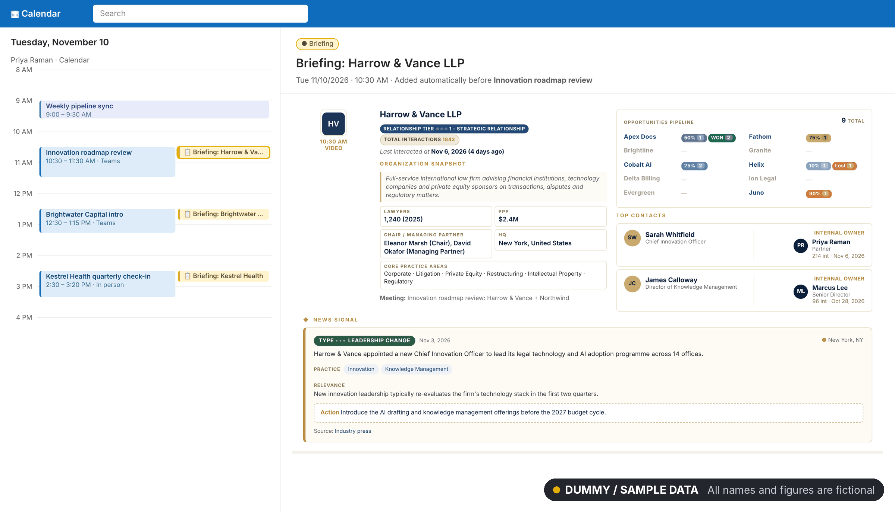
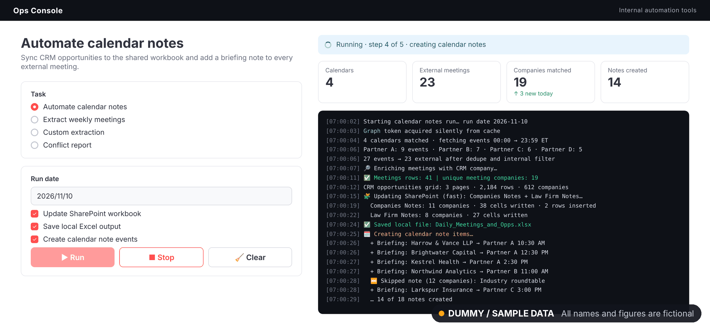
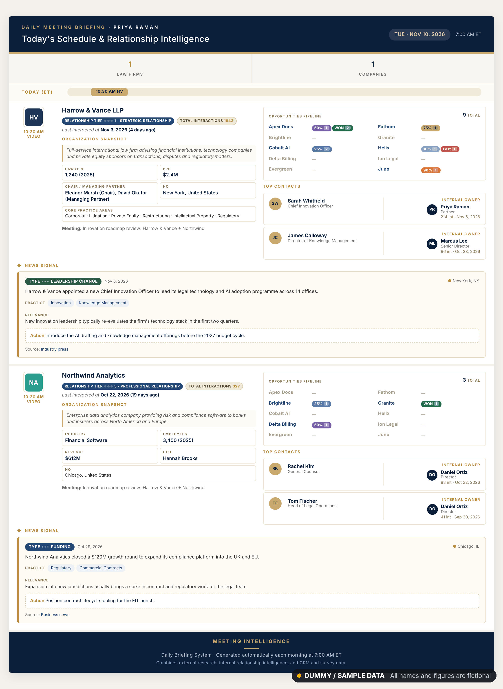
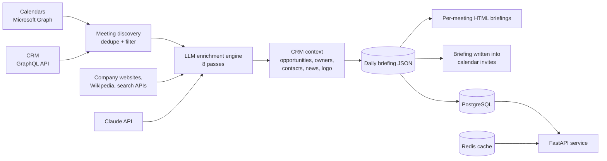
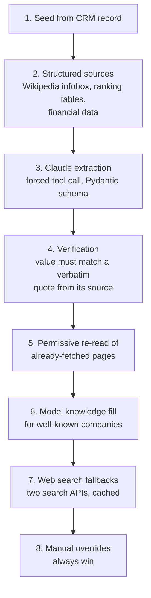

# AI Daily Briefing System

An automated pipeline that reads the day's calendars, works out which outside companies are in each meeting, researches every company with an LLM enrichment engine, and delivers a one-page briefing for each meeting straight into the calendar invite.

> **Note:** this system runs in production on client data, so the source code is private. This repository documents the design, architecture and results. Screenshots show the real interface running on **dummy / sample data**: all company names, people and figures are fictional.

---

## The problem

Before every client meeting, someone had to look up the company by hand: what it does, its size and leadership, the open sales opportunities, who on the team knows the contacts, and any recent news. With many external meetings a day across several calendars, this research was slow and easy to skip.

## What it does

- **Reads every partner calendar** for the day through Microsoft Graph, skips internal meetings, and keeps one entry per meeting per calendar.
- **Matches attendees to 17,800+ CRM companies** by email through the CRM's GraphQL API.
- **Researches each company** with an eight-pass, Pydantic-validated LLM enrichment engine (details below).
- **Adds relationship context** from the CRM: open opportunities by stage, last interaction, internal owners and key contacts, plus the latest news signal and the company logo.
- **Delivers a briefing per meeting**, written into the calendar invite and available as an email-ready HTML page.
- **Serves the same data to other systems** through a FastAPI service.

## Screenshots

**Briefing added to the calendar, right before the meeting**

**Operations console running the daily workflow**

<b>Full briefing page for a meeting (click to expand)</b>

---

## Architecture

### The enrichment engine

Each company goes through up to eight passes. Every pass only fills fields that are still empty, so cheap and reliable sources run first and the LLM fills the gaps.

### Grounding and validation

- Claude is called with a **forced tool call** at temperature 0, so output always matches a **Pydantic** schema.
- Every extracted value must come with a **source URL and a verbatim quote**. Values that cannot be found in the fetched text are dropped rather than guessed.
- Fields like profits per partner are only filled when the exact phrase appears in a source; they are never derived or estimated.
- Each field keeps a **provenance record** (confidence, source, quote), so any value in a briefing can be traced back.

### Reliability

- **Retry with backoff** on Microsoft Graph calls.
- **Circuit breakers** on search APIs: after repeated failures a source is switched off for the rest of the run instead of slowing every company.
- **Graceful failure:** if enrichment fails for one company, its briefing still ships with the CRM data, so one bad company never breaks the day.
- **Disk caches** for search answers and logos, so reruns cost nothing.
- Pages that need JavaScript are rendered with **Playwright**; plain pages use a fast HTTP client first.

### Data and serving

- **PostgreSQL** holds the CRM company mirror and the enriched company snapshots, with schema managed by **Alembic** migrations.
- **Redis** caches news signals per company with an expiry (cache-aside).
- A **FastAPI** service returns the snapshot and latest signals for any meeting's attendees, protected by API keys, with a health check covering both stores.
- PostgreSQL, Redis and the API run together under **Docker Compose** with health checks, started by a single command.

### Briefing delivery

- Briefings are rendered as **email-client-safe HTML** (table layout and inline styles), because modern Outlook strips CSS grid.
- One briefing per meeting per calendar owner, so each person only sees their own meetings.
- An operations console runs the daily workflow in the background, streams its logs live, and syncs CRM opportunities into a shared SharePoint workbook.

---

## Tech stack

| Area | Tools |
|---|---|
| Language | Python |
| LLM | Claude API (tool calling), Pydantic |
| APIs | Microsoft Graph (calendars, mail, SharePoint), CRM GraphQL API, FastAPI |
| Data | PostgreSQL, SQLAlchemy, Alembic, Redis, pandas |
| Web data | httpx, Playwright, BeautifulSoup, readability |
| Infrastructure | Docker, Docker Compose |
| Auth | MSAL (OAuth2) for Microsoft 365 |

## What I learned

- **Cheap sources first, LLM last.** Ordering the passes by cost and reliability made results more accurate and cut API spend.
- **Make the model prove it.** Requiring a verbatim source quote for every value removed most hallucinated facts.
- **Design for partial failure.** A briefing with some fields missing is far more useful than no briefing at all.

---

## Author

**Adiba Khan** · Software Engineer · Backend & AI Systems

